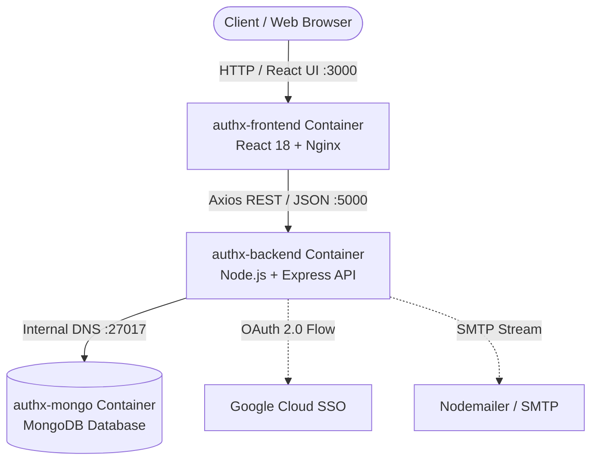

# 🛡️ AuthX - Enterprise-Grade Authentication & Session Intelligence Platform

[](https://github.com/SailokeshNalabothu/AuthX/actions/workflows/ci.yml)
[](https://nodejs.org/)
[](https://react.dev/)
[](https://www.mongodb.com/)
[](https://www.docker.com/)
[](https://jestjs.io/)
[](https://opensource.org/licenses/ISC)

> **AuthX** is a production-hardened, full-stack identity, session intelligence, and access management platform engineered with **Node.js**, **Express**, **MongoDB**, and **React**. Designed to meet modern enterprise SaaS standards (Google & Clerk style), AuthX delivers active multi-session tracking, RFC 6238 TOTP two-factor authentication, cryptographic backup recovery codes, dual-token JWT architecture with silent refresh interceptors, rate-limiting brute-force defenses, Google OAuth 2.0 SSO, and role-based access control.

---

## 📑 Table of Contents

- [System Architecture](#-system-architecture)
- [Enterprise Features](#-enterprise-features)
  - [Active Device & Session Intelligence](#1-active-device--session-intelligence-clerk--google-style)
  - [Two-Factor Authentication (TOTP 2FA)](#2-two-factor-authentication-totp-2fa)
  - [Cryptographic Backup Recovery Codes](#3-cryptographic-backup-recovery-codes)
  - [Dual-Token JWT Architecture & Silent Refresh](#4-dual-token-jwt-architecture--silent-refresh)
  - [Brute-Force Protection & Account Lockout](#5-brute-force-protection--account-lockout)
  - [Federated Single Sign-On (Google OAuth 2.0)](#6-federated-single-sign-on-google-oauth-20)
  - [Role-Based Access Control (RBAC)](#7-role-based-access-control-rbac)
  - [Transactional HTML Email Engine](#8-transactional-html-email-engine)
- [Tech Stack](#-tech-stack)
- [REST API Reference](#-rest-api-reference)
- [Testing & Quality Assurance](#-testing--quality-assurance)
- [Quick Start Guide](#-quick-start-guide)
  - [Method 1: Docker Container Orchestration](#method-1-docker-container-orchestration-recommended)
  - [Method 2: Native Manual Installation](#method-2-native-manual-installation)
- [Environment Configuration](#-environment-configuration)
- [Project Directory Structure](#-project-directory-structure)
- [Security Hardening](#-security-hardening)
- [License](#-license)

---

## 🏛 System Architecture

The AuthX infrastructure is built as a modular 3-tier microservice architecture orchestrated via Docker Compose:



### Microservice Containers

| Container Name | Technology | Internal Port | Host Port | Purpose |
| :--- | :--- | :--- | :--- | :--- |
| `authx-frontend` | React 18, Axios, React Router v6 | `80` (Nginx) | `3000` | SaaS client UI, session dashboard, route guards |
| `authx-backend` | Node.js, Express.js, Passport.js | `5000` | `5000` | REST API, token issuance, session and 2FA controller |
| `authx-mongo` | MongoDB Engine | `27017` | `27017` | Persistent identity storage, session store, indexes |

---

## 🚀 Enterprise Features

### 1. Active Device & Session Intelligence (Clerk & Google Style)

- **Comprehensive Fingerprinting:** Zero-dependency User-Agent and IP address parsing extracting device category (Desktop/Mobile/Tablet), Operating System, browser vendor, and client IP.
- **Concurrent Session Tracking:** Each active login allocates an isolated session document mapped with a unique session ID.
- **Granular Control & Revocation:** Users can inspect all connected devices, identify the current device via active markers, selectively terminate individual sessions, or execute **"Sign Out All Other Devices"** in a single click.
- **Heartbeat & Focus Verification:** Client-side event listeners trigger session verification upon browser window refocus.

### 2. Two-Factor Authentication (TOTP 2FA)

- **Standard RFC 6238 Compliance:** Interoperable with Google Authenticator, Authy, Microsoft Authenticator, and 1Password.
- **Provisioning Workflow:** Generates cryptographically secure base32 secrets alongside high-resolution dynamic QR codes (`qrcode`).
- **Challenge Interception:** When 2FA is active, initial password verification issues a temporary 2FA ticket requiring rolling 6-digit TOTP verification before issuing access tokens.

### 3. Cryptographic Backup Recovery Codes

- **Emergency Access:** Generates 8 cryptographically random single-use recovery codes formatted as `XXXX-XXXX`.
- **Hashed Storage:** Backup codes are irreversibly hashed using `bcrypt` before database persistence to prevent leakages.
- **Authenticated Regeneration:** Users can invalidate existing codes and generate fresh sets at any time by confirming their current password.

### 4. Dual-Token JWT Architecture & Silent Refresh

- **Access Token:** Short-lived (15 minutes) bearer token for validating authorized API requests.
- **Refresh Token:** Long-lived (7 days) credential stored securely to negotiate token renewals.
- **Transparent Refresh Interceptors:** The React frontend integrates Axios response interceptors that trap `401 Unauthorized` responses and silently request new access tokens in the background without UI interruption.

### 5. Brute-Force Protection & Account Lockout

- **Progressive Account Freezing:** Automatically locks accounts for 15 minutes after 5 consecutive failed login attempts.
- **Sliding Window Rate Limiting:** Backed by `express-rate-limit` to restrict high-frequency authentication attempts per IP address.

### 6. Federated Single Sign-On (Google OAuth 2.0)

- **Passport.js Strategy:** Clean OAuth 2.0 handshakes managing profile discovery and email verification.
- **Automated User Synchronization:** Links existing user profiles or creates verified accounts seamlessly.
- **Secure Token Redirection:** Redirects to the frontend callback route (`/google-success`) with short-lived query credentials.

### 7. Role-Based Access Control (RBAC)

- **Hierarchical Authorization:** Clean separation of privileges between `user` and `admin` roles.
- **Declarative Middleware Guards:** `roleMiddleware('admin')` protects administrative routes, user deletion, and role elevation.
- **Client Route Guards:** Custom `<ProtectedRoute>` and `<AdminRoute>` components decode JWT payloads client-side for immediate UI restriction.

### 8. Transactional HTML Email Engine

- **Automated Dispatching:** Integrated via Nodemailer with environment-driven SMTP fallback support.
- **Responsive HTML Templates:** Inline-styled templates for OTP Registration Verification, Password Recovery (10-minute expiry token), and Welcome notifications.

---

## 🛠 Tech Stack

```
Core Frameworks      : Node.js (v20+), Express.js (v5), React.js (v18)
Database & ODM       : MongoDB, Mongoose (v9)
Security & Auth      : JSON Web Tokens (JWT), bcryptjs, Speakeasy, Passport.js, Express-Rate-Limit
Email Engine         : Nodemailer
Testing Framework    : Jest (v30), Supertest (v7), Cross-Env
DevOps & Containers  : Docker, Docker Compose, Nginx, GitHub Actions CI
Frontend Routing & UI: React Router v6, Axios, React Toastify, Lucide Icons, Custom Modern CSS
```

---

## 📡 REST API Reference

### Authentication Endpoints (`/api/auth`)

| Method | Endpoint | Access | Description |
| :--- | :--- | :--- | :--- |
| `POST` | `/api/auth/signup` | Public | Register new account and dispatch 6-digit email OTP |
| `POST` | `/api/auth/verify-otp` | Public | Verify registration OTP to activate user account |
| `POST` | `/api/auth/login` | Public (Rate-limited) | Authenticate user; returns tokens or 2FA challenge |
| `POST` | `/api/auth/login-2fa` | Public (Rate-limited) | Complete 2FA login via TOTP code or backup code |
| `POST` | `/api/auth/forgot-password` | Public | Request password reset token via email |
| `POST` | `/api/auth/reset-password/:token`| Public | Reset password using verified reset token |
| `POST` | `/api/auth/refresh` | Public | Exchange valid Refresh Token for fresh Access Token |
| `GET` | `/api/auth/google` | Public | Initiate Google OAuth 2.0 authentication flow |
| `GET` | `/api/auth/google/callback` | Public | Google OAuth redirect handler and token emitter |

### Session Management Endpoints (`/api/sessions`)

| Method | Endpoint | Access | Description |
| :--- | :--- | :--- | :--- |
| `GET` | `/api/sessions` | Bearer Token | Retrieve all active sessions for the current user |
| `DELETE` | `/api/sessions/:id` | Bearer Token | Terminate a specific session by ID |
| `POST` | `/api/sessions/revoke-others` | Bearer Token | Terminate all active sessions except the current one |

### Two-Factor Authentication Endpoints (`/api/2fa`)

| Method | Endpoint | Access | Description |
| :--- | :--- | :--- | :--- |
| `GET` | `/api/2fa/status` | Bearer Token | Get current 2FA status and remaining backup codes count |
| `POST` | `/api/2fa/setup` | Bearer Token | Generate TOTP secret, backup codes, and QR code URI |
| `POST` | `/api/2fa/verify` | Bearer Token | Verify TOTP code and enable 2FA on the account |
| `POST` | `/api/2fa/disable` | Bearer Token | Disable 2FA by providing password and TOTP code |
| `POST` | `/api/2fa/regenerate-backup-codes` | Bearer Token | Invalidate old and generate 8 new backup recovery codes |

### User & Administration Endpoints (`/api/users`)

| Method | Endpoint | Access | Description |
| :--- | :--- | :--- | :--- |
| `GET` | `/api/users` | Admin Role | List all registered users with metadata |
| `DELETE` | `/api/users/:id` | Admin Role | Delete a user account by ID |
| `PUT` | `/api/users/:id/role` | Admin Role | Update user role (`user` / `admin`) |

---

## 🧪 Testing & Quality Assurance

AuthX features an automated test pipeline built with **Jest** and **Supertest**, delivering comprehensive test coverage across authentication, sessions, security, and authorization.

```bash
# Execute test suite locally
npm test
```

### Test Suite Execution Status

```
PASS tests/auth.test.js
PASS tests/admin.test.js
PASS tests/password.test.js
PASS tests/protected.test.js
PASS tests/session.test.js
PASS tests/oauth.test.js

Test Suites: 6 passed, 6 total
Tests:       20 passed, 20 total
Snapshots:   0 total
Status:      100% Passing
```

### Enterprise Pipeline Safeguards

- **Isolated Test Database (`authx_test`):** Jest initializes a dedicated test database cluster, preventing destructive collisions with development data.
- **Deterministic Sequential Execution (`--runInBand`):** Eliminates asynchronous race conditions during database read/write cycles.
- **Stateless Environment Encapsulation (`tests/envMock.js`):** Tests run on reproducible mock configuration, allowing tests to pass instantly on any freshly cloned machine.
- **SMTP Stream Interception (`jest.mock`):** Nodemailer network connections are mocked during test runs, preventing network latency and socket timeouts in CI environments.
- **GitHub Actions CI:** Automated pipeline running on Ubuntu with containerized MongoDB services across every pull request and push to `main`.

---

## ⚡ Quick Start Guide

### Method 1: Docker Container Orchestration (Recommended)

Ensure [Docker Desktop](https://www.docker.com/) is installed and running, then execute:

```bash
# Clone the repository
git clone https://github.com/SailokeshNalabothu/AuthX.git
cd AuthX

# Launch all 3 services (Frontend, Backend, MongoDB)
docker-compose up --build
```

- **Frontend Application:** [http://localhost:3000](http://localhost:3000)
- **Backend API Server:** [http://localhost:5000](http://localhost:5000)
- **MongoDB Database:** `localhost:27017`

### Method 2: Native Manual Installation

#### Prerequisites

- **Node.js:** v20.x or higher
- **MongoDB:** Running locally on `mongodb://127.0.0.1:27017`
- **npm:** v9.x or higher

#### 1. Backend Setup

```bash
# Install backend dependencies
npm install

# Create environment configuration
cp .env.example .env

# Start development server
npm run dev
```

The backend API will initialize on `http://localhost:5000`.

#### 2. Frontend Setup

```bash
# Navigate to frontend directory
cd authx-frontend

# Install frontend dependencies
npm install

# Start React development server
npm start
```

The frontend client will open on `http://localhost:3000`.

---

## ⚙️ Environment Configuration

### Backend Environment (`.env`)

| Variable | Description | Default / Example |
| :--- | :--- | :--- |
| `PORT` | HTTP server port | `5000` |
| `NODE_ENV` | Runtime environment (`development` / `production` / `test`) | `development` |
| `MONGO_URI` | MongoDB connection connection string | `mongodb://127.0.0.1:27017/authx` |
| `ACCESS_TOKEN_SECRET` | Cryptographic secret for signing Access Tokens | `your_access_token_secret` |
| `REFRESH_TOKEN_SECRET`| Cryptographic secret for signing Refresh Tokens | `your_refresh_token_secret` |
| `JWT_SECRET` | Fallback signing secret | `your_fallback_secret` |
| `EMAIL_USER` | SMTP email address for transactional notifications | `your_email@gmail.com` |
| `EMAIL_PASS` | SMTP app password or credentials | `your_app_password` |
| `GOOGLE_CLIENT_ID` | Google Cloud OAuth Client ID | `your_client_id.apps.googleusercontent.com` |
| `GOOGLE_CLIENT_SECRET`| Google Cloud OAuth Client Secret | `your_client_secret` |
| `CLIENT_URL` | Frontend origin for CORS and OAuth redirection | `http://localhost:3000` |

### Frontend Environment (`authx-frontend/.env`)

| Variable | Description | Default / Example |
| :--- | :--- | :--- |
| `REACT_APP_API_URL` | Base endpoint for the backend REST API | `http://localhost:5000/api` |

---

## 📂 Project Directory Structure

```
AuthX/
├── .github/
│   └── workflows/
│       └── ci.yml               # GitHub Actions CI workflow
├── authx-frontend/              # React 18 SPA Client
│   ├── public/                  # Static assets & index.html
│   ├── src/
│   │   ├── components/          # Reusable UI cards, modal guards, navbars
│   │   ├── pages/               # Login, Signup, Dashboard, 2FA, Admin pages
│   │   ├── services/            # Axios instance & token refresh interceptors
│   │   ├── App.js               # Route declarations & route guards
│   │   └── index.css            # Modern SaaS design system & theme
│   ├── Dockerfile               # Multi-stage production Nginx container
│   ├── nginx.conf               # Frontend reverse proxy configuration
│   └── package.json
├── src/                         # Express Backend API
│   ├── config/                  # Database, Passport.js, & OAuth configurations
│   ├── controllers/             # Auth, Session, 2FA, & User business logic
│   ├── middleware/              # JWT verification, RBAC, & rate limiters
│   ├── models/                  # Mongoose schemas (User, Session)
│   ├── routes/                  # Modular express route definitions
│   ├── services/                # Nodemailer email dispatch service
│   ├── templates/               # Transactional HTML email templates
│   ├── utils/                   # Device fingerprinting & token helpers
│   └── app.js                   # Express application setup
├── tests/                       # Automated Jest test suites
│   ├── admin.test.js            # RBAC & administrative operation tests
│   ├── auth.test.js             # Signup, OTP verification, & login tests
│   ├── envMock.js               # Mock environment variables for testing
│   ├── oauth.test.js            # Google OAuth strategy tests
│   ├── password.test.js         # Reset password & recovery token tests
│   ├── protected.test.js        # Route guard verification tests
│   ├── session.test.js          # Multi-device session & revocation tests
│   └── setup.js                 # Global Jest configuration hooks
├── Dockerfile                   # Backend Docker container definition
├── docker-compose.yml           # Multi-container orchestration (Dev/Local)
├── docker-compose.prod.yml      # Production container orchestration
├── package.json                 # Backend dependencies & test scripts
├── server.js                    # Server entry point & DB connection
└── README.md                    # Project documentation
```

---

## 🔒 Security Hardening

- **Salted Hashing:** User passwords and recovery codes are hashed using `bcryptjs` with high salt rounds.
- **Ephemeral Token Lifetimes:** Access tokens expire in 15 minutes to reduce exposure windows.
- **Strict Scope Authorization:** Granular RBAC middleware verifies user role on every protected query.
- **CORS Protection:** Cross-Origin Resource Sharing is strictly constrained to authorized client origins.
- **Stateless Revocation:** Sessions and refresh tokens are verified against persistent database records, allowing instant revocation across all devices.

---

## 📄 License

This project is licensed under the [ISC License](https://opensource.org/licenses/ISC).
